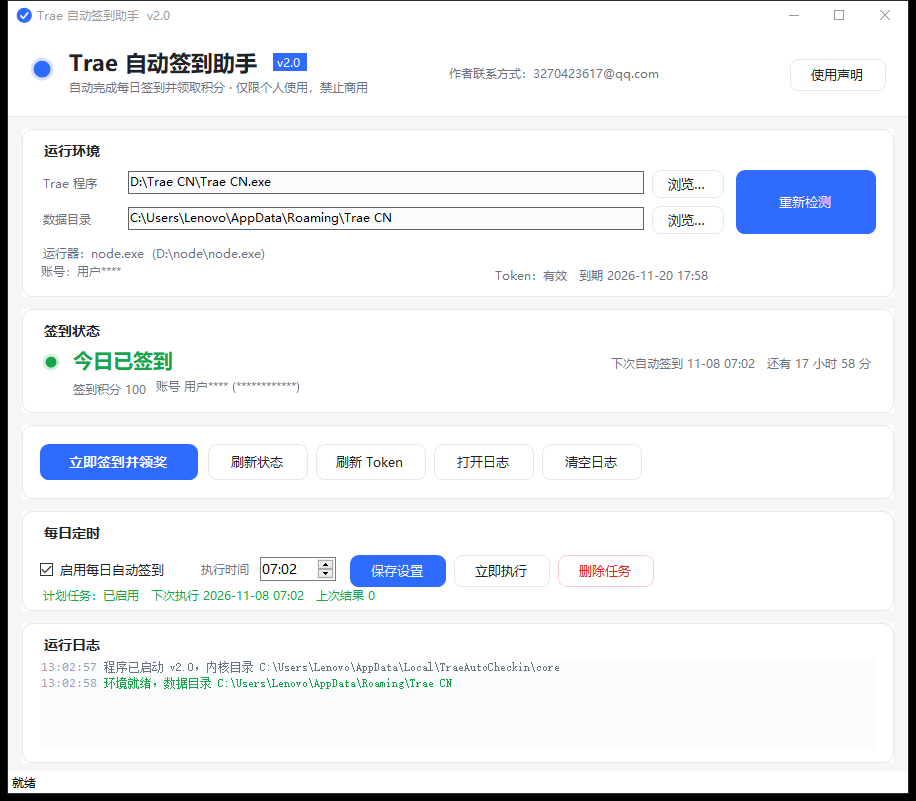
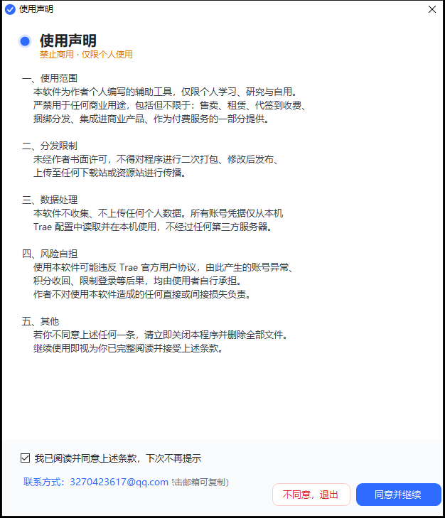

<div align="center">

# Trae 自动签到助手

**每天 07:02 自动签到领积分，多账号批量托管，全程本地运行**

[](https://github.com/luoleiyong)
[](https://dotnet.microsoft.com)
[](https://nodejs.org)
[](https://github.com/luoleiyong)
[]()

</div>

---

## 这是什么

一个给 **Trae CN**（字节跳动 AI IDE，基于 VS Code）用的自动签到工具。

Trae 每天签到能领 100 积分，但必须打开 IDE 手动点。这个工具把它变成开机自启的后台任务：每天固定时间读一次本机 Trae 的登录凭据，调用签到接口，再把结果写回日志和界面。

不需要填账号密码，不需要任何额外配置，不需要浏览器自动化 —— 直接复用你机器上已经登录好的 Trae 凭据。

> 只在本机读写你已有的登录状态，不上传、不转发、不修改 Trae 本体。

---

## 界面





---

## 特性

| 能力 | 说明 |
|---|---|
| **每日自动签到** | 计划任务在指定时间唤醒，无窗口静默执行，签完自动退出 |
| **多账号托管** | 账号库支持导入多个 Trae 账号，一键批量签到，互不干扰 |
| **凭据自动续期** | 过期前自动续期，不用重新登录 Trae |
| **活动奖励领取** | 签到之外顺带扫一遍活动接口，能领的裂变/下载奖励一并领掉 |
| **智能退避** | 遇到限流、会话失效、套餐限制分别按不同间隔重试，不做无效请求 |
| **积分历史** | 每日积分落盘，可查连续签到天数和近 7 日趋势 |
| **换机自适应** | 程序启动时自动校正计划任务路径，拷贝到新电脑直接能用 |
| **单文件部署** | 主程序 104 KB，安装包 128 KB，零依赖（内核已内嵌） |

---

## 快速开始

### 方式一：安装包（推荐）

1. 从 [Releases](https://github.com/luoleiyong/TraeAutoCheckin/releases) 下载 `TraeAutoCheckinSetup.exe`
2. 双击运行，勾选同意使用声明
3. 安装完自动创建桌面快捷方式和计划任务

安装位置：`%LOCALAPPDATA%\Programs\TraeAutoCheckin`（免管理员权限）

首次启动会读取本机 Trae 的登录态。如果 Trae 还没登录，先打开 Trae 登录一次再运行本工具。

### 方式二：源码运行

需要 Node.js 18+：

```bash
git clone https://github.com/luoleiyong/TraeAutoCheckin.git
cd TraeAutoCheckin

node src/checkin.mjs status     # 查看今日签到状态
node src/checkin.mjs run        # 立即签到
node src/checkin.mjs brief      # 精简状态输出
```

没有单独装 Node 也能跑 —— 脚本会自动回退到 Trae 自带的 Electron 运行时（`ELECTRON_RUN_AS_NODE=1`）。

### 方式三：直接跑 exe

`dist\TraeAutoCheckin.exe` 是绿色单文件，双击即用，不需要安装。

---

## 命令行

```bash
# 单账号
node src/checkin.mjs status              # 签到状态 / 积分 / 有效期
node src/checkin.mjs run                 # 签到（默认不领活动奖励）
node src/checkin.mjs run --grants        # 签到 + 领取可领的活动奖励
node src/checkin.mjs refresh             # 强制刷新 token
node src/checkin.mjs token               # 打印当前 token
node src/checkin.mjs env                 # 探测 Trae 安装位置和数据目录
node src/checkin.mjs brief               # KV 格式精简输出（给 GUI 用）

# 多账号
node src/checkin.mjs import              # 把当前 Trae 登录态导入账号库
node src/checkin.mjs accounts            # 列出账号库（JSON）
node src/checkin.mjs add --token <JWT>   # 粘贴 token 添加账号
node src/checkin.mjs remove --id <userId>
node src/checkin.mjs runall              # 全部账号签到
node src/checkin.mjs runall --grants --interval 2000
```

---

## 它怎么工作

一句话：复用你电脑上已经登录好的 Trae 凭据，在本地完成签到，再把结果写进日志和界面。

```
本机 Trae 登录态  →  本地校验  →  调用签到服务  →  记录积分
```

整个流程全部在你自己的电脑上跑完：

- **不碰密码**：程序只读取 Trae 自己保存的登录信息，拿不到也不需要你的账号密码
- **不上传数据**：除签到请求本身外没有任何外发流量，账号信息只留在本地
- **不改 Trae 本体**：不注入进程、不动安装目录、不接管网络，Trae 照常升级
- **可随时撤销**：删掉程序目录和计划任务，电脑立刻回到没装过的状态

具体实现请直接看 `src/` 下的源码，每个模块都有注释。

---
## 文件结构

```
TraeAutoCheckin/
├── src/                        内核（Node.js ESM，无外部依赖）
│   ├── trae-crypto.mjs         本地凭据编解码
│   ├── trae-platform.mjs       Trae 安装路径 / 数据目录探测
│   ├── trae-auth.mjs           凭据读取与续期
│   ├── trae-api.mjs            签到服务调用
│   ├── trae-accounts.mjs       账号库 / 积分历史 / 重试策略
│   ├── trae-checkin-core.mjs   签到流程编排
│   └── checkin.mjs             CLI 入口
├── gui/                        WinForms 外壳（C# 5，无 NuGet 依赖）
│   ├── Theme.cs                配色 / 自绘控件
│   ├── Core.cs                 内嵌内核释放 / 进程调度 / 计划任务
│   ├── MainForm.cs             主界面
│   ├── DisclaimerForm.cs       使用声明
│   └── Installer.cs            安装/卸载程序
├── dist/                       编译产物
└── docs/                       开发笔记
```

内核以资源形式编译进 exe，运行时解压到 `%LOCALAPPDATA%\TraeAutoCheckin\core`，所以绿色版和安装版都不需要外挂文件。

---

## 编译

需要 .NET Framework 4.0 自带的编译器（Windows 系统自带，不用装 SDK）：

```bat
set CSC=C:\Windows\Microsoft.NET\Framework64\v4.0.30319\csc.exe

%CSC% /target:winexe /codepage:65001 /optimize+ /out:dist\TraeAutoCheckin.exe ^
  /reference:System.Windows.Forms.dll /reference:System.Drawing.dll ^
  /resource:src\trae-crypto.mjs,TraeAutoCheckin.core.trae-crypto.mjs ^
  ... ^
  gui\Theme.cs gui\DisclaimerForm.cs gui\Core.cs gui\MainForm.cs gui\Program.cs
```

安装包同理，把 `TraeAutoCheckin.exe` 作为资源 `Installer.payload.exe` 编进 `Installer.cs`。

---

## 常见问题

**Q：提示「未找到 Trae 登录信息」怎么办？**

先打开 Trae 并登录一次，再运行本工具。凭据加密存在 Trae 自己的数据目录里，必须先有一次真实登录。

**Q：会不会把 token 传到别的服务器？**

不会。所有请求只发往 Trae 官方服务，和 IDE 自己发的完全一样。账号库存在本地 `%LOCALAPPDATA%\TraeAutoCheckin\data`，没有任何上报逻辑。

**Q：换电脑要重新配置吗？**

不用。把 exe 拷过去运行，程序会自动检测计划任务路径不匹配并重建。

**Q：多个账号会不会互相顶掉？**

不会。每个账号存自己的 deviceId 和 token，批量签到时按顺序执行并留间隔。

**Q：签到时间能改吗？**

界面上「每日定时」卡片里直接改，保存后立即重建计划任务。

---

## 免责声明

- 本项目仅限**个人学习与研究**使用，禁止任何形式的商业用途（售卖、代签收费、捆绑分发、集成进商业产品）
- 未经作者许可，不得二次打包、修改后发布或上传至任何下载站传播
- 使用本工具可能违反 Trae 官方用户协议，由此产生的账号异常、积分回收、限制登录等后果由使用者自行承担
- 本工具不收集、不上传任何个人数据，所有凭据仅在本机读取和使用

继续使用即视为已完整阅读并接受上述条款。

---

## 联系

问题反馈或功能建议：**3270423617@qq.com**

如果这个工具帮到了你，点个 Star 就是最好的支持。